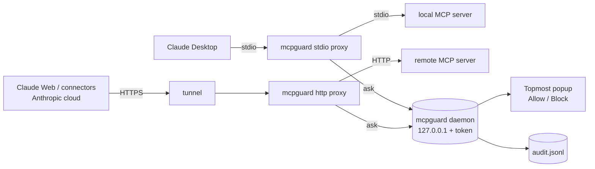

# MCP Guard

Approve or block every MCP request that Claude Desktop or Claude Web makes, in a popup that appears on top of
your other windows. Blocked requests never reach the MCP server; Claude is told why, and says so in the chat.

Pure Python standard library (Tk for the popup), no third-party dependencies.

## How it works



Claude reaches MCP servers in two ways, so there are two interception points that share one decision service:

| Client | Transport | Interception |
|---|---|---|
| Claude Desktop, local servers | Desktop starts each server as a child process and speaks JSON-RPC over stdin/stdout | `mcpguard install` rewrites `claude_desktop_config.json` so Desktop starts `mcpguard stdio -- <original command>`, which starts the real server and relays every line |
| Claude Web (claude.ai) and Desktop custom connectors | Anthropic's cloud sends Streamable HTTP requests to the connector URL | `mcpguard http --upstream <server>` is a reverse proxy; the connector URL points at it (through a tunnel such as cloudflared) |

Both proxies parse each JSON-RPC message. Requests that do something (`tools/call`, `resources/read`,
`prompts/get`) are sent to the daemon and held until the user decides. Everything else (initialize, list
calls, pings, notifications, responses) passes through immediately and is written to the audit log, so the
connection keeps working while a request waits.

- **Allow**: the original message is forwarded to the server, and its reply goes back to Claude.
- **Block, closing the popup, or no answer within 60 s**: the server never sees the request. For a tool call,
  Claude gets a tool result with `isError: true` and the text "Blocked by MCP Guard: denied by user. The request
  was not sent to the server.", which is how MCP reports tool failures, so the model reads the reason and tells
  the user (a protocol-level error would only show up as a generic "connector error"). Blocked
  `resources/read` and `prompts/get` requests, which have no such result, get JSON-RPC error `-32001`.
- **Several requests at once**: each pending request waits on its own thread (JSON-RPC ids match replies to
  requests), popups stack, and unrelated traffic is never held up.
- **Remember**: a tick box applies the same decision to that server + tool until the daemon restarts.

### Modules

| File | Responsibility |
|---|---|
| `mcpguard/jsonrpc.py` | Which messages need approval; denial replies; shared JSON helpers |
| `mcpguard/approval.py` | The daemon (`POST /decide`), the `ask()` client, remembered rules, audit log |
| `mcpguard/ui.py` | Tk popups: small, topmost, one per request, countdown to auto-block, Esc / Ctrl+Enter |
| `mcpguard/monitor.py` | Live window that follows the audit log: every message in both directions and every decision |
| `mcpguard/stdio_proxy.py` | Claude Desktop local servers |
| `mcpguard/http_proxy.py` | Remote servers for Claude Web and connectors, with SSE streamed through |
| `mcpguard/install.py` | Wraps and unwraps servers in the Claude Desktop config (keeps a `.bak`) |

The daemon takes its decision function as a parameter, so the tests drive it with a scripted "user" and no
screen.

## Install

Requires Python 3.10+ with Tk (included in the python.org installers for Windows and macOS).

```bash
git clone <this repo> && cd mcp-guard
pip install -e ".[dev]"
```

If the `mcpguard` command is not on your PATH, use `python -m mcpguard` instead in every command below.

## Run

1. **Start the daemon** and leave it running. On Windows, `pythonw` runs it without a console window.
   ```bash
   mcpguard daemon            # or: pythonw -m mcpguard daemon
   ```
2. **Claude Desktop (local servers).** Quit Claude Desktop, then run:
   ```bash
   mcpguard install           # mcpguard uninstall restores the original config
   ```
   Start Claude Desktop again. Every tool call from a local server now shows the popup.
3. **Claude Web / connectors (remote servers).**
   ```bash
   mcpguard http --upstream https://your-mcp-server.example.com --port 8080
   cloudflared tunnel --url http://127.0.0.1:8080
   ```
   In claude.ai, go to Settings → Connectors → Add custom connector, and use the tunnel URL plus the
   server's path (for example `https://<random>.trycloudflare.com/mcp`). Paths, headers and OAuth discovery
   are forwarded unchanged.

4. **Watch the traffic (optional).**
   ```bash
   mcpguard monitor           # or: pythonw -m mcpguard monitor
   ```
   A live table of every JSON-RPC message (Claude to server, server to Claude, and denials sent by the guard)
   and every decision, coloured by outcome. Click a row to see the full message. It only reads
   `audit.jsonl`, so it can be opened or closed at any time.

### Settings (environment variables)

| Variable | Default | Meaning |
|---|---|---|
| `MCPGUARD_TIMEOUT` | `60` | Seconds before an unanswered popup blocks the request |
| `MCPGUARD_PORT` | `8765` | Daemon port (bound to 127.0.0.1 only) |
| `MCPGUARD_HOME` | `~/.mcpguard` | Token file and `audit.jsonl` |

### Trying it without other servers

`tests/fake_server.py` is a dependency-free MCP server with two harmless tools (`echo` and `delete_file`).
Add it to `claude_desktop_config.json`, then run `mcpguard install`:

```json
{ "mcpServers": { "demo": { "command": "python", "args": ["C:/path/to/mcp-guard/tests/fake_server.py"] } } }
```

Ask Claude to "echo hello with the demo tool". Click **Allow** and the result comes back. Ask again and click
**Block**, and Claude reports that MCP Guard blocked the call.

## Tests

```bash
pytest -q
```

The tests run the real daemon, the real proxies as subprocesses, and the fake server. They cover allow, block,
concurrency (a slow approval does not hold up a later request), the daemon being down, the HTTP proxy,
remembered rules, and an install/uninstall round trip.

## Security and reliability

- **Fail closed.** If the daemon is down, the token is wrong, or nobody answers in time, the request is denied
  and never forwarded.
- **Local only.** The daemon listens on 127.0.0.1. Callers must send a random token that is regenerated at
  each start and stored in a file only the user can read; the comparison is constant-time.
- **Clean shutdown.** If Claude closes the connection, the proxy stops the server; if the server exits, the
  proxy exits so Claude sees it. Upstream HTTP errors (such as a 401 for OAuth) pass through unchanged, and an
  unreachable upstream returns 502.
- **Audit trail.** Every message in both directions (kind, id, method, and a copy capped at 4,000 characters) and every
  decision is appended to `~/.mcpguard/audit.jsonl`. The log stays on this machine.
- **Readable popups.** Arguments are shown in full, pretty-printed, and cut off at 5,000 characters.

## Limitations and trade-offs

- **Claude Web needs the HTTP proxy.** claude.ai connectors are called from Anthropic's servers, not from the
  browser, so a browser extension or local hook cannot see them. Intercepting them means sitting in front of
  the MCP server: the proxy has to be reachable from the internet (a tunnel), and the connector has to point at
  it. Built-in Anthropic-hosted connectors (Gmail, Drive and so on) cannot be intercepted by any local tool.
- **Desktop extensions** (`.mcpb`, installed from Settings → Extensions) are launched outside
  `claude_desktop_config.json` and are not wrapped yet.
- **Client timeouts.** Remote clients may give up on a request held for a long time; keep `MCPGUARD_TIMEOUT`
  short for remote use.
- **Batches.** JSON-RPC batches (removed in the 2025-06-18 spec) are split into single messages on stdio. Over
  HTTP, one denied call answers the whole POST.
- **Remembered rules** are kept in memory only, by design, so a restart always asks again.
